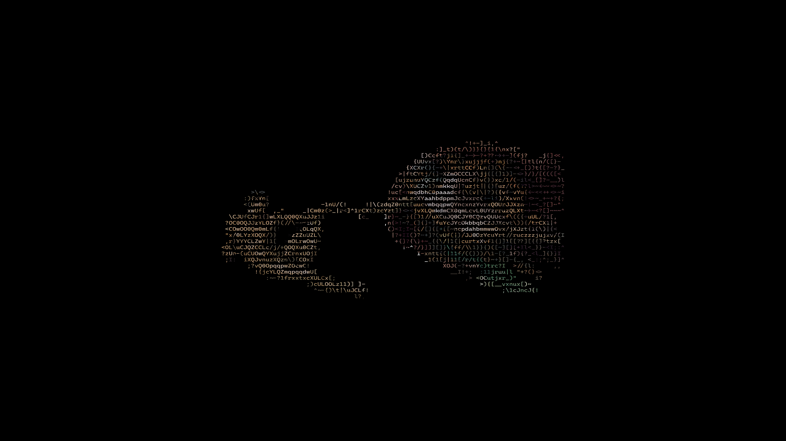

# Divine

A dark, cool-toned theme for [Omarchy](https://omarchy.org/) — slate-blue accents over near-black, paired with magenta Yaru icons and four 4K wallpapers.



## Requirements

- [Omarchy](https://omarchy.org/) v4 or newer (Hyprland)
- The `Yaru-magenta` icon theme (shipped with Omarchy's Yaru package)

## Install

```bash
omarchy theme install https://github.com/smblasik/divine.git
```

Or from Walker: **Install → Style → Theme**, paste the URL above, and press Enter.

Manual install:

```bash
git clone https://github.com/smblasik/divine.git ~/.config/omarchy/themes/divine
omarchy theme set divine
```

`omarchy theme install` takes the theme name from the repository name, so this repo installs as `divine`.

## What's included

| Path | Purpose |
| --- | --- |
| `colors.toml` | Omarchy palette (dark mode) |
| `icons.theme` | Icon theme — `Yaru-magenta` |
| `backgrounds/` | Four 4K wallpapers |
| `preview.png` | Preview image |

Cycle the wallpapers with:

```bash
omarchy theme bg next
```

## Palette

| Role | Color |
| --- | --- |
| Background | `#111318` |
| Dark background | `#0d0e12` |
| Darker background | `#090a0c` |
| Lighter background | `#292b2f` |
| Foreground | `#e5e9f0` |
| Muted | `#232731` |
| Accent | `#81a1c1` |
| Selection | `#e5e9f0` / `#2e3440` |
| Red | `#bf616a` |
| Orange | `#c97980` |
| Yellow | `#ebcb8b` |
| Green | `#a3be8c` |
| Cyan | `#88c0d0` |
| Blue | `#81a1c1` |
| Magenta | `#b48ead` |
| Brown | `#79494d` |

## Backgrounds

| File | Resolution | Source |
| --- | --- | --- |
| `wallhaven-gw1xyl.png` | 3840 × 2160 | [wallhaven.cc/w/gw1xyl](https://wallhaven.cc/w/gw1xyl) |
| `wallhaven-rqrqpm.png` | 3840 × 2160 | [wallhaven.cc/w/rqrqpm](https://wallhaven.cc/w/rqrqpm) |
| `wallhaven-rr31k1.png` | 8000 × 4500 | [wallhaven.cc/w/rr31k1](https://wallhaven.cc/w/rr31k1) |
| `wallhaven-xewljv.jpg` | 3840 × 2160 | [wallhaven.cc/w/xewljv](https://wallhaven.cc/w/xewljv) |

## Notes

- The palette was generated with [Aether](https://github.com/bjarneo/aether) for Omarchy v4.
- The `.aether-managed` marker is local Aether state and is excluded from this repository.
- This theme ships only colors, icons, and wallpapers — no Lua, terminal configs, or editor configs — so Omarchy's repo-install staging rules do not remove any of its files.

## Credits

- [Omarchy](https://omarchy.org/) by DHH and contributors
- Palette generated with [Aether](https://github.com/bjarneo/aether) by bjarneo
- Wallpapers from [Wallhaven](https://wallhaven.cc/), by their original authors

## License

The theme configuration in this repository (`colors.toml`, `icons.theme`, and documentation) is released under the [MIT License](LICENSE).

The wallpapers in `backgrounds/` are the work of their original authors and remain subject to their own terms on Wallhaven. They are **not** covered by the MIT license.
